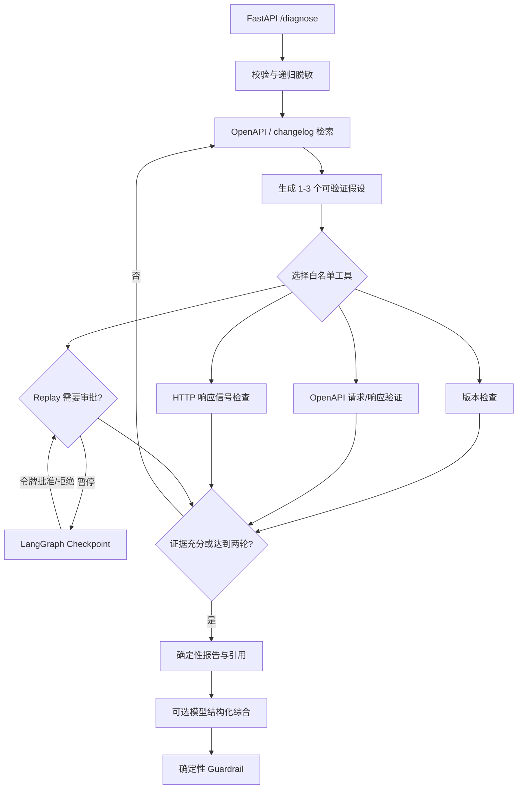

# Third-Party API Diagnosis Agent

面向学生开发者的第三方 HTTP JSON API 集成故障诊断与验证 Agent。输入一次脱敏请求、响应或错误现象，系统检索 OpenAPI 与 changelog，维护少量根因假设，选择确定性工具验证，并输出带引用、修复建议和复验步骤的结构化报告。

项目边界是一个可重复的 Weather Mock 合同，不声称支持任意生产 API。默认流程完全离线；真实模型调用和 HTTP Replay 都必须显式开启。

2026-10-16 维护：修复 Replay 结果未进入最终诊断、同线程旧状态残留、模型同标签伪造事实、跨任务 Replay 配额耗尽、模式参数静默忽略、Provider 综合失败未降级等问题。回归与验证边界见 [维护记录](docs/maintenance-2026-10-16.md)。

## 已实现能力

- `openapi-core` 请求/响应 Schema 验证，输出稳定故障标签和 JSON Pointer 证据。
- changelog 版本检查、关键词与 metadata 混合检索、受控 Mock Replay。
- LangGraph 状态包含候选假设、已选工具、验证结果、循环次数、审批状态和 Trace。
- 检索结果参与假设生成；第一次工具结果会改变第二轮查询和工具，最多两轮。
- 离线确定性规划器，以及可选的 LangChain `bind_tools` 真实模型规划器；非法或缺失 Tool Call 会显式降级。
- Replay 在图内使用 `interrupt` 暂停，审批令牌校验后从同一内存 Checkpoint 恢复。
- Provider prompt 前递归脱敏；确定性 Guardrail 同时保护标签、根因、证据和修复建议。
- Replay 具有 origin/method 白名单、DNS 与私网防护、非幂等审批、超时、次数和大小限制。
- 45 条人工编写且请求指纹唯一的 Ground Truth；离线结果保留 oracle 来源标记。
- FastAPI、pytest、Ruff、mypy、coverage、锁定依赖、非 root Docker 和 GitHub Actions 配置。

## 架构



LangChain 负责 `Document`、Retriever、结构化 Tools、模型接口和 `bind_tools`；LangGraph 负责 State、条件分支、两轮循环、Checkpoint 与 HITL。OpenAPI、版本和 Replay 结论由确定性工具产生，模型不能覆盖相冲突的工具证据。

## 本地运行

要求 Python 3.12。可使用锁文件安装可复现环境：

```powershell
py -3.12 -m venv .venv
& .\.venv\Scripts\python.exe -m pip install -r requirements-dev.lock -r requirements-build.lock
& .\.venv\Scripts\python.exe -m pip install --no-deps --no-build-isolation -e .
& .\.venv\Scripts\python.exe -m pytest
```

分别启动 Mock API 和诊断服务：

```powershell
& .\.venv\Scripts\uvicorn.exe api_diagnosis.mock_api:app --port 8001
& .\.venv\Scripts\uvicorn.exe api_diagnosis.api:app --port 8000
```

访问 `http://127.0.0.1:8000/docs`，或提交诊断：

```powershell
$body = @{
  request = @{
    request_id = "demo-001"
    method = "POST"
    path = "/weather/forecast"
    headers = @{ "X-API-Version" = "v2" }
    body = @{ city = "Singapore"; units = "metric" }
  }
} | ConvertTo-Json -Depth 6

Invoke-RestMethod -Method Post -Uri http://127.0.0.1:8000/diagnose `
  -ContentType application/json -Body $body
```

在 `mode=agent` 请求中加入 `replay_requested=true` 会在 Replay 前返回 `pending_approval`。随后把 `thread_id`、`approval_token` 和 `approved` 发送到 `POST /diagnose/resume`；错误令牌或不存在的 Checkpoint 会被拒绝。`mode=provider` 与 `mode=deterministic` 不支持 Replay，携带该标记会返回 422；不能把模型规划与离线审批描述成同一条已集成链路。

## 真实模型

模型依赖是可选的：

```powershell
& .\.venv\Scripts\python.exe -m pip install -e ".[llm]"
$env:OPENAI_API_KEY = "<process-only-secret>"
$env:OPENAI_BASE_URL = "https://your-openai-compatible-endpoint/v1"
$env:OPENAI_MODEL = "your-model"
$env:OPENAI_STRUCTURED_OUTPUT = "0"  # Provider 不支持 json_schema 时使用一次严格 JSON 调用
```

FastAPI Provider 模式默认关闭，避免匿名请求产生外部费用。只有设置 `API_DIAGNOSIS_ENABLE_PROVIDER=1` 后，`/diagnose` 的 `mode=provider` 才可调用模型。结构化输出失败不会默认偷偷再请求一次；只有显式设置 `OPENAI_JSON_FALLBACK_RETRY=1` 才允许第二次调用。

Provider 最终综合超时或输出不可解析时返回确定性诊断，并标记 `execution_metadata.synthesis_source=deterministic_fallback`。默认 Guardrail 保护所有事实字段，标签相同也不接受模型编造的根因、证据或修复方案。SDK 的每次请求超时和重试可配置；这不代表整个诊断请求有可强制中断的统一截止时间。

真实三组评测：

```powershell
$env:REAL_EVAL_MODES = "direct,rag,agent"
$env:REAL_EVAL_GUARDRAIL = "0"
$env:REAL_EVAL_OUTPUT = "eval-results/real-evaluation-v2.json"
& .\.venv\Scripts\python.exe scripts\run_real_eval.py
```

脚本在 Provider 返回 usage metadata 时记录 Token，并始终记录逐案例标签、错误、平均/p50/p95 延迟和数据集 ID；不会写入密钥、Prompt 或请求体。可用 `REAL_EVAL_LIMIT` 做分层抽样冒烟，但正式结果必须注明样本数。

## 评测与质量门

离线评测：

```powershell
$env:OFFLINE_EVAL_OUTPUT = "eval-results/offline-evaluation.json"
& .\.venv\Scripts\python.exe scripts\run_eval.py
```

当前 45 条独立输入的离线结果：HTTP 信号启发式类别准确率 55.56%，检索上下文 + 合同启发式 93.33%，LangGraph + 确定性工具 100%。最后一项明确标记 `oracle_derived_rate=100%`，只能证明回归、工具编排与证据链正确，不能声称模型泛化准确率。完整指标和真实 Provider 结果见 [evaluation.md](docs/evaluation.md)。

本地质量门：

```powershell
& .\.venv\Scripts\python.exe -m ruff check src tests scripts
& .\.venv\Scripts\python.exe -m mypy
& .\.venv\Scripts\python.exe -m coverage run -m pytest
& .\.venv\Scripts\python.exe -m coverage combine
& .\.venv\Scripts\python.exe -m coverage report
& .\.venv\Scripts\python.exe -m pip check
```

2026-10-16 本地结果：47 tests passed、mypy 17 个源文件无错误、Ruff 和 `pip check` 通过；语句与分支合并覆盖率 82.25%，单独分支覆盖率 70.90%。配置中的 80% 门槛检查综合覆盖率，不能称为分支覆盖率达 80%。原始输出见 [本次检查](eval-results/maintenance-2026-10-16/checks.json)。GitHub Actions 已配置但尚未执行云端验证。

## Docker

```powershell
docker build -t api-diagnosis-agent:local .
docker run --rm -p 8000:8000 api-diagnosis-agent:local
```

镜像固定 Python 基础镜像 digest，使用锁文件安装，以非 root `app` 用户运行并包含 `/health` healthcheck。Docker 只启动诊断服务；需要真实 Replay 时，应单独运行 Mock API 并显式配置容器可访问的 allowlist origin。

## 目录

```text
src/api_diagnosis/
  api.py          FastAPI 诊断、Provider 和审批恢复边界
  agent.py        LangGraph 假设、工具选择、验证循环与模型适配
  diagnosis.py    确定性报告底座
  retrieval.py    OpenAPI/changelog 文档加载与可引用检索
  validation.py   openapi-core 请求/响应适配器
  versioning.py   changelog 版本证据
  replay.py       受控 HTTP Replay
  security.py     脱敏、origin、DNS 与私网安全规则
  resilience.py   总预算 timeout/retry/fallback
  evaluator.py    带来源标记的离线基线与指标
```

## 已知边界

- 只验证一个自建 Weather Mock 合同，不代表任意生产 API 能力。
- 默认 Retriever 是可解释的 metadata + 关键词检索，不是 Embedding/向量数据库。
- Checkpoint 使用进程内 `InMemorySaver`，服务重启后待审批状态会丢失。
- 45 条数据用于固定回归，不是统计意义上的模型排行榜。
- Docker 锁定准确版本但未包含每个 wheel 的 hash，也未生成完整 SBOM。
- `/evaluate` 面向本地演示；部署到公网前仍需要认证、限流和任务队列。

复用决策和许可证见 [reuse-decision.md](docs/reuse-decision.md) 与 [THIRD_PARTY.md](THIRD_PARTY.md)。上一级 `00-新会话项目上下文.md` 是项目范围与完成定义。
